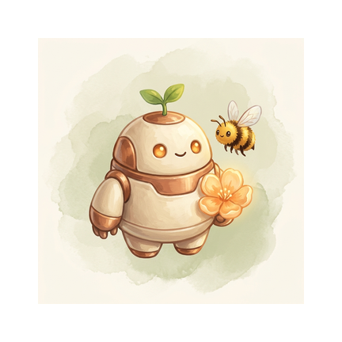

<p align="center">
  
</p>

# La Clairière aux abeilles

Un jeu mobile botanique et apicole paisible développé en **Kotlin** & **Jetpack Compose**, inspiré du prototype web [La clairière aux abeilles.html](./La%20clairi%C3%A8re%20aux%20abeilles.html).

> **Télécharger l'APK Android** : [LaClairiereAuxAbeilles-v1.0.0.apk](https://github.com/cedricboucard/La-Clairiere-aux-Abeilles/releases/latest) (section *Releases*)

Accompagne un petit robot jardinier au pied du Grand Arbre : récolte des fruits ambrés, sème des fleurs au fil des saisons, suis le vol des abeilles pour découvrir la mare et répare la passerelle vers l'autre rive.

---

## Écrans & Fonctionnalités

- **Accueil** (`AccueilScreen.kt`) : écran d'ouverture illustré avec résumé de la partie en cours, reprise rapide, création d'une nouvelle clairière et *Grimoire du jardinier*.
- **Clairière Principale — Jeu & HUD** (`ClairiereScreen.kt`) :
  - Monde interactif `1400×820` rendu sur `Canvas` Compose avec défilement horizontal tactile.
  - Cycle des 4 saisons (*Printemps*, *Été*, *Automne*, *Hiver*) avec palette dynamique et particules saisonnières (pétales, lucioles, feuilles, neige).
  - Cueillette des fruits ambrés, plantation des 7 espèces de fleurs, trajectoires et pollinisation des abeilles, déblocage du passage des fougères, réparation de la passerelle et exploration de l'autre rive.
  - Sons doux procéduraux (`SoftSoundPlayer.kt`) via `AudioTrack` et sauvegarde locale automatique (`SharedPreferences`).
- **Mon Carnet** (`CarnetScreen.kt`) :
  - **Flore Botanique** : herbier des 7 espèces (*Bouton d'Ambre*, *Trèfle Rose*, *Iris des Berges*, *Nénuphar Étoilé*, *Menthe Sauvage*, *Campanule Lunaire*, *Bruyère Dorée*) avec sélection directe pour semer.
  - **Lieux & Saisons** : suivi du cycle naturel et de la progression dans les 4 zones de la clairière.
- **La Ruche — Sanctuaire Apicole** (`RucheScreen.kt`) :
  - Réserve de miel ambré à récolter, vols de butinage interactifs et bénédictions de la Reine améliorables avec le pollen royal.

---

## Stack Technique

- **Langage** : Kotlin (JVM 17)
- **UI** : Jetpack Compose, Material 3, Compose `Canvas`
- **Architecture** : `AndroidViewModel` + `StateFlow` + boucle de simulation 60 FPS par coroutines
- **SDK** : `minSdk = 26`, `compileSdk = 36`, `targetSdk = 36`, AGP `9.0.1`

---

## Compiler & Exécuter

```bash
cd ClairiereAuxAbeilles
./gradlew assembleDebug
```

Pour installer sur un appareil ou émulateur connecté via `adb` :

```bash
adb install -r app/build/outputs/apk/debug/app-debug.apk
adb shell am start -n fr.clairiere.abeilles/.MainActivity
```

---

## Structure du Dépôt

- `La clairière aux abeilles.html` : prototype HTML/Canvas original ayant servi de base au jeu.
- `ClairiereAuxAbeilles/` : projet Android complet (Gradle, code Kotlin, ressources et icône adaptative).
